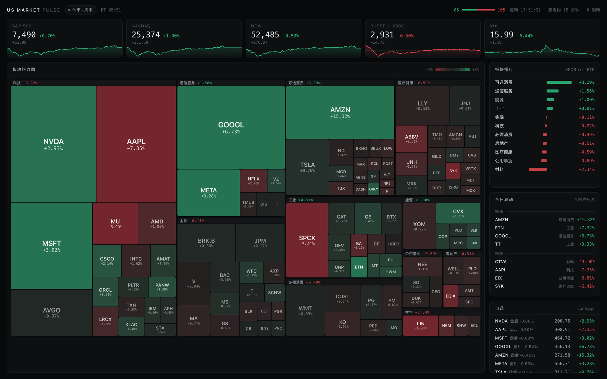

# US Market Pulse

美股盘中看板。一屏看完大盘、板块、异动、自选，开盘后打开就不用动了。



```bash
npm start   # → http://localhost:5173
```

零依赖，不用 `npm install`，Node ≥ 18 直接跑。约 3300 行。
成分股每天自动跟随标普 500 调仓，不用手工维护名单。

---

# 用法

顶栏导航切页，或按 `1` `2` `3` `4`。任意一只票点进去是个股页，`Esc` 回来。

| 页面 | 看什么 |
|---|---|
| **总览** | 自选（主区）、大盘、板块排行、异动 |
| **财报** | 未来两周谁出财报，按日期分组 |
| **宽度** | 今天是普涨，还是被几只大票拉起来的 |
| **宏观** | 美债收益率、原油黄金、美元、加密 |

## 总览

| 区域 | 内容 |
|---|---|
| 顶栏 | 交易时段 + 倒计时、美东日期、全市场涨跌家数条 |
| 指数条 | 标普 / 纳指 / 道指 / 罗素 2000 / VIX，带当日分时，虚线是前收。VIX **配色是反的**，跌显示绿色 |
| 板块排行 | 11 只行业 ETF 按涨跌排序，中间是零轴 |
| 今日异动 | 全部成分股的领涨领跌各四只 |
| 自选 | 主视图。每只一张卡片：现价涨跌、当日分时、日内和 52 周区间、成交量对 10 日均量，近两周有财报或创 52 周新高低会打标签 |

卡片上的「10 日均量的 xx%」是到目前为止的成交量，盘中会一路涨，过 150% 变黄。
顶栏的涨跌家数比指数更诚实——指数被几只大票拉起来的时候，这里会露馅。

## 个股页

主图上方价格、下方成交量。当日 / 5 日是分时，1 月 ~ 5 年是日线蜡烛，全部是 1999 年起的月线。
鼠标移上去出十字线，右上角显示那一根的日期、开高低收、涨跌、成交量。

右侧三块：**关键指标**（市盈率、EPS、ROE、毛利率等十八项，拿不到的显示 `—`）、
**52 周区间**（白线是当前价的位置，两端标着价格和到达日期）、
**同板块**（该板块**全部**成分股按涨跌排序，点任意一行换页）。

顶部会出现标签：下次财报日（带盘前/盘后）、除息日、停牌、创 52 周新高低。

> 区间选择会记住，换看别的股票时沿用上次那个。

## 财报 / 宽度 / 宏观

**财报**按日期分组，每天内部按市值排——同一天出财报，大票才带得动指数。
带「预估」标记的是交易所还没定档、CNBC 自己推算的，**按它安排事情前最好去公司官网确认**。

**宽度**最该看的是「背离」＝ 等权 − 市值加权。接近 0 说明涨跌普遍；
明显为负说明大票跑赢小票、指数被少数几只撑着。举个真实的例子：某天标普 +0.70% 看着不错，
但涨跌家数是 85 涨 105 跌、等权 −0.21%，背离 −1.22%——超过一半的股票其实在跌。
下面的直方图看分布形状，离散度那张图看板块是"整体在涨"还是"被一两只拉起来的"。

**宏观**的收益率涨跌按**基点（bp）**显示，不是百分比。颜色只表方向，不替你判断好坏。

## 自选

面板右上角点「编辑」：每张卡片右上角出现 `×` 点掉即移除，最后一格输入框敲代码回车即添加（小写自动转大写）。
加了查不到的代码会**当场报错**，列表不动。最多 50 只。

改动存在服务端（`data/watchlist.json`），换浏览器、换设备看到的是同一份。
`config.js` 里的 `WATCHLIST` 只是首次启动的初始值，想推倒重来就删掉那个文件。

> 存盘后要重拉两百多只成分股的报价，列表刷新出来要几秒。回车后会先弹「已添加 XXXX」，不用重复按。

## 交互

| 操作 | 效果 |
|---|---|
| 点击任意一只票 | 进个股页（自选卡片 / 异动 / 指数卡都能点） |
| `1` `2` `3` `4` | 切页 |
| `R` | 强制刷新，绕过服务端缓存 |
| `Esc` | 从个股页返回 |

页面自动刷新：交易中 30s，盘前盘后 60s，休市 5min，切回标签页立刻补一次。

## 配置

改 [`config.js`](config.js)，存盘刷新页面即可，不用重启。

| 项 | 作用 |
|---|---|
| `INDICES` | 顶部指数，建议保持 5 个 |
| `MACRO` | 宏观页的分组和品种 |
| `SECTORS[].pin` | 强制算进某板块的股票。行业 ETF 只装标普 500 成分股，新股通常要满一年才够格，这类要手动 pin（现在 pin 了 SpaceX） |
| `HOLDINGS_PICK` | 每个板块取几只成分股。异动榜和宽度页都从这里算 |
| `MARKET_CLOSURES` | 一次性休市（国丧、天灾），常规节假日不用写 |

符号用 CNBC 的写法：股票直接写 ticker，A/B 股用点号（`BRK.B`），指数前面带点（`.SPX`）。

为 1440×900 及以上设计。窄于 860px 会堆叠成单列，能看，但主力场景是桌面大屏。

---

# 实现

## 技术路线

一个 Node 进程，没有依赖、没有构建、没有数据库。

```
CNBC 报价  ┐                                            ┌ 总览
CNBC K线   ├→  server.js  →  /api/*  →  store.js  →  路由 ┼ 财报 / 宽度 / 宏观
SSGA 持仓  ┘   代理·缓存·归一化          轮询·订阅         └ 个股
```

**服务端只做三件事**：代理上游、缓存、把脏数据洗干净。浏览器不直连行情源——
既省掉跨域，也让"多开几个标签页"不等于"多打几倍接口"。归一化是重头戏：
上游的字段是给网页渲染用的字符串（`"127,585,441"`、`"4.858T"`、`"0.50%"`），
还会拿 `0` 表示"这项不适用"，一路透传到界面就会变成"市盈率 0.00"这种假数据。

**前端是原生 ESM，没有构建步骤。** 改完存盘刷新就生效。
`<script type="module">` 直接跑，`import` 走真实路径，浏览器自己解析依赖图。

**一个 store，单向广播。** `/api/overview` 那份数据是全市场的——顶栏、总览、财报页、
宽度页都要用，个股页也要拿它算同板块对比。所以拉取和轮询节奏都收在 `store.js`，视图只订阅。
放进视图里的话，切一次页就断一次节奏、重来一轮请求。

**视图就是个函数**：`view(host, params)`，往容器里画，返回一个清理函数。
路由切换时先清理旧的再挂新的——监听和订阅漏收一次，就会有两个视图同时在刷，
而且从界面上看不出来。

**状态只有两个 JSON 文件**：`data/holdings.json`（成分股，12 小时刷一次）和
`data/watchlist.json`（自选）。没有数据库，没有会话。

## 数据从哪来

**上游一共只有三个地址**，宏观页也不例外——黄金、原油、美债收益率、比特币、汇率
走的是跟股票**完全相同的那个报价接口**，只是符号不同（`@GC.1` `@CL.1` `US10Y` `BTC=` `EUR=`）。

| 地址 | 供给 | 性质 |
|---|---|---|
| `quote.cnbc.com` | 报价、基本面、财报日 —— 股票 / 指数 / 期货 / 外汇 / 加密 / 收益率 | CNBC 网页自己的后端，无文档 |
| `ts-api.cnbc.com` | K 线与分时，同样覆盖以上全部品种 | 同上 |
| `www.ssga.com` | 11 只行业 ETF 的每日持仓 xlsx | 公开文件，发行商有义务披露 |

都不需要 key，但**免 key 不等于公开 API**：SSGA 那个是真正的公开文件，
CNBC 那两个只是恰好没锁门的内部端点，随时可能变。**报价约 15 分钟延迟。**

缓冲的做法：服务端缓存（报价 60s、K 线 180s），失败回退上一份缓存，
`data/holdings.json` 跟着仓库提交、首次启动碰上 SSGA 连不上也能跑。

> 弱点说在前面：上游要是改了字段名，解析不出来的股票会**静静消失**，不报错。
> 页面看着正常，数据其实少了。

## 目录

```
server.js       唯一入口：静态服务 + 4 个 API + 缓存 + 交易时段
config.js       需要手改的都在这
lib/            holdings 持仓抓取 · xlsx 自研解析 · market-calendar 交易日历 · watchlist 自选读写
public/js/      store 数据源 · router 路由 · chrome 顶栏 · chart K线 · spark 分时 ·
                fmt · dom · ui（纯函数，无状态）
public/views/   overview 总览 · earnings 财报 · breadth 宽度 · macro 宏观 · symbol 个股
```

加一个页面 = `views/` 加一个文件 + `app.js` 加一行路由 + `chrome.js` 的 `NAV` 加一项。

## 接口

| 路径 | 说明 |
|---|---|
| `GET /api/overview` | 总览全量。`?force=1` 绕过缓存 |
| `GET /api/symbol?s=NVDA&range=1Y` | 个股报价 + K 线 |
| `GET /api/macro` | 宏观分组行情 + 分时 |
| `POST /api/watchlist` | 改自选。唯一的写接口 |

财报页和宽度页没有自己的接口，全从 `/api/overview` 已有的数据算出来。

默认只监听 `127.0.0.1`——自选是可写的、没有鉴权，绑到全网卡等于把它开放给整个局域网。
要在手机上看：`HOST=0.0.0.0 npm start`，只在信得过的网络里这么做。

## 几个关键取舍

- **成分股不写死。** 每天从 SSGA 拉 11 只 SPDR 行业 ETF 的官方持仓，按权重挑。
  这 11 只加起来正好是标普 500，指数调仓、并购退市都自动跟上。
  双重股权（GOOGL/GOOG）会合并，否则 Alphabet 会被算两遍。

- **交易日历按规则算，不是一张日期表。** 写死的表每年要人续，忘了续就悄悄失效——
  失效的方式恰恰是"看起来一切正常"。浮动假日按"第 n 个星期几"算，
  耶稣受难日走复活节算法。元旦有个例外：1 月 1 日是周六时不关前一天。

- **K 线走 canvas。** 一屏最多五百多根蜡烛加同样多的成交量柱，SVG 就是两千多个节点，
  切区间会肉眼可见地卡。蜡烛间距不足 3.5px 时退回收盘线——挤成一片不如一条线清楚。

- **收益率按基点。** 上游给的 `change_pct` 是"收益率这个数字涨了百分之多少"，
  4.660 → 4.718 会给成 `+1.18%`，实际是 `+5.8bp`。照搬会让人读错一个数量级。

- **上游档位名字不可信。** K 线接口的 `1M` 给的是约一年的日线，`5Y` 是十年周线。
  所以 1 月 / 3 月 / 6 月 / 1 年四个区间都从同一份日线里切，少打接口，切换还命中缓存。

## 已知边界

- 异动榜和宽度页用的是各板块权重靠前的公司，不是全市场，看的是大票的脸色。
  个股页的"同板块"是全的，可以在那里对照。
- 板块涨跌幅取的是对应行业 ETF，跟成分股加权会有小幅出入。
- 上游是非官方接口，随时可能失效。个人用途。

| 现象 | 处理 |
|---|---|
| 弹「行情获取失败」 | 数据源临时抽风，页面继续显示上一份数据，等下次自动刷新 |
| 数字一直不动 | 看顶栏，休市会写明原因（周末 / 节假日名） |
| 明明休市却显示交易中 | 临时停市（国丧之类），加到 `MARKET_CLOSURES` |
| 某只股票凭空消失 | 被移出标普 500 了，想留着就 `pin` 进来 |
