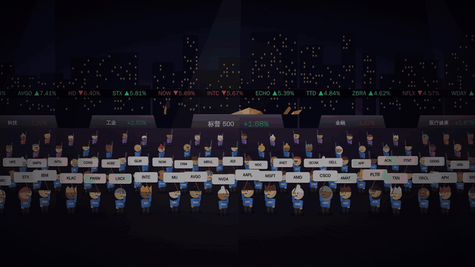

# slapmarket · 美股打屁股大会

**把美股变成一场打屁股大会：100 家大公司化身小人，涨的站上绿柱、跌的站上红柱，收盘时涨幅前十挨个打跌幅前十的屁股。**



<sub>动图里是演示数据。</sub>

柱子高度就是涨跌幅，后面立着大盘和四大板块的铜牛 / 铜熊，涨是牛、跌是熊。
鼠标悬停任何一个小人看详情，点一下右边滑出实时盘面。

```bash
npm start        # → http://localhost:5173
npm run check    # 数据源自检：哪一路不通，一眼看出来
npm test
```

零依赖，Node ≥ 18。

## 能干什么

- **实时舞台**：交易时段 30 秒一刷。名次变了，人会走着换位置；涨幅第一戴皇冠，跌幅第一头顶下雨的乌云
- **悬停**任何一个小人或雕塑：现价、分时、日内 / 52 周区间、量比；板块雕塑还列出板块里涨跌最猛的几只
- **点击**：右边滑出实时盘面——K 线（当日到全部 8 个区间）、十字线读数、关键指标
- **收盘大戏**：25 秒的打屁股动画。`空格` 随时演；页面开着时美股一收盘自动演一遍；「录视频」直接下载，带声音
- **音效**：浏览器里现场合成的卡通音效。行情每刷新一次轻轻响一声，大盘涨是大调、跌是小调

快捷键：`空格` 收盘大戏 · `R` 强制刷新 · `Esc` 关闭盘面

## 数据

| 用途 | 先问 | 备用 |
|---|---|---|
| 股票、三大指数的报价 | 新浪（一个请求六十只，实时） | Yahoo |
| VIX、罗素等新浪没有的报价 | Yahoo 图表接口 | — |
| K 线、分时 | Yahoo 图表接口 | 新浪 |
| 个股基本面 | Yahoo（要 crumb，常被限流，拿不到就空着） | — |
| 标普 500 名单 | SSGA 官网 11 只行业 ETF 的每日持仓，进出自动跟上 | `data/holdings.json` |

哪一路失败了，服务器终端会打一行原因，接下来 3 分钟自动改走另一家。

## 代码

```
server.js              三个接口：/api/market 全量 · /api/live 快刷 · /api/symbol 单只
config.js              所有可调的：板块、缓存时间、端口
lib/
  market-data.js       行情的唯一入口：谁先问、谁兜底、熔断
  providers/           sina 新浪 · yahoo
  holdings.js          标普 500 成分股（xlsx.js 解析 SSGA 的持仓表）
  market-hours.js      交易日历和当前时段，节假日按规则算
public/
  app.js               入口
  arena/               page 页面装配 · live 实时舞台 · show 收盘大戏 · drawer 侧边盘面 ·
                       cast 选角站位 · backdrop 布景 · person 小人 · statue 低多边形雕塑 ·
                       sound 合成音效 · math
  js/                  store 行情轮询 · chart K 线 · widgets 小部件 · fmt 格式化 · dom
scripts/check-sources  数据源自检
tests/                 交易日历、成分股变动、新浪 K 线解析
```
